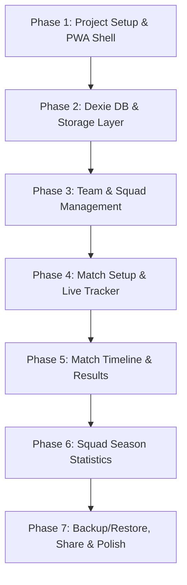

# Match Tracker - Application Development Plan

## 1. Executive Summary & Architecture

Match Tracker is a mobile-first, offline-first Progressive Web Application (PWA) tailored for grassroots and amateur football (UK) coaches, parents, and managers. It provides live match tracking (playing time, goalkeeper rotation, goalscorers, powerplay extra players, and substitutions), squad season statistics, match history timelines, and exportable match summaries.

### Architecture Decisions
- **Frontend Stack**: Next.js 15 (React 19, App Router, TypeScript).
- **Styling**: Vanilla CSS & CSS Modules utilizing a centralized design token system (`styles/tokens.css`). Pure CSS for maximum performance, responsiveness, and zero bloated build steps.
- **Data Persistence**: 100% on-device local storage via **IndexedDB** using **Dexie.js** (reactive observables, zero server/cloud dependency, privacy-focused, works seamlessly offline).
- **PWA & Offline Support**: Web App Manifest (`manifest.json`), custom Service Worker with Cache-First asset strategy, and automated PWA install prompt banner (`beforeinstallprompt` listener).
- **Pitch-Side Mobile Enhancements**:
  - **Screen Wake Lock API**: Keeps the device screen awake during live matches so coaches aren't interrupted by screen timeouts mid-game.
  - **Audio & Haptic Feedback**: Whistle audio cues on period completion and subtle vibration feedback (`navigator.vibrate`) on goal/substitution actions.
  - **Drift-Free Match Clock**: Timer calculated from timestamps (`performance.now()` / `Date.now()`) with paused duration accumulation rather than simple `setInterval` increments, preventing timing drift if the browser tab is backgrounded.

---

## 2. Data Schema & IndexedDB Model (Dexie.js)

```typescript
// db/schema.ts

export interface Team {
  id: string; // UUID
  name: string;
  createdAt: number;
  updatedAt: number;
}

export interface Player {
  id: string; // UUID
  teamId: string;
  name: string;
  isActive: boolean; // true = active squad, false = inactive/former player
  createdAt: number;
  updatedAt: number;
}

export type MatchFormat = '3v3' | '5v5' | '7v7' | '9v9' | '11v11' | 'custom';

export type MatchStatus = 'setup' | 'in_progress' | 'paused' | 'completed';

export type MatchEventType =
  | 'goal_for'
  | 'goal_against'
  | 'substitution'
  | 'gk_swap'
  | 'powerplay_in'
  | 'powerplay_out'
  | 'period_start'
  | 'period_end';

export interface MatchEvent {
  id: string;
  matchId: string;
  type: MatchEventType;
  timestampSeconds: number; // match clock second
  period: number; // 1 = 1st half, 2 = 2nd half, etc.
  playerId?: string; // player who scored, or player coming ON
  subOutPlayerId?: string; // player coming OFF (for substitution or GK swap)
  notes?: string;
  createdAt: number;
}

export interface PlayerMatchStint {
  playerId: string;
  role: 'outfield' | 'goalkeeper';
  startSecond: number;
  endSecond?: number; // populated when subbed off or period/match ends
}

export interface Match {
  id: string;
  teamId: string;
  opposition: string;
  date: string; // ISO date string (YYYY-MM-DD)
  format: MatchFormat;
  targetPeriods: number; // default 2 (halves)
  periodDurationMinutes: number; // e.g. 20, 25, 30
  currentPeriod: number;
  status: MatchStatus;
  
  // Running state
  elapsedSeconds: number;
  scoreFor: number;
  scoreAgainst: number;
  
  // Starting lineup & bench definitions
  startingGoalkeeperId: string;
  startingOutfieldPlayerIds: string[];
  benchPlayerIds: string[];
  
  // Real-time tracking intervals & events
  stints: PlayerMatchStint[];
  events: MatchEvent[];
  
  createdAt: number;
  completedAt?: number;
}
```

---

## 3. Core Modules & Page Flows

### 3.1. Home & Team Selection (`/`)
- **First Launch**: Clean welcome screen prompting the user to create their first team.
- **Multi-Team Support**: List existing teams with squad counts and quick access.
- **PWA Install Banner**: Native-style dismissible prompt at top/bottom when app is accessed via mobile browser.
- **Data Management**: Fast access to Backup/Restore (JSON export & import).

### 3.2. Team Hub (`/teams/[teamId]`)
- **Team Header**: Edit team name inline, view current record summary.
- **Action Grid**:
  - **Start Match** -> navigates to Match Setup.
  - **Squad & Stats** -> navigates to Squad Page.
  - **Results History** -> navigates to Results List.
- **Roster Quick View**: List active players, with quick inline "Add Player" field.

### 3.3. Squad Management & Season Statistics (`/teams/[teamId]/squad`)
- **Player Stats Table / Cards**:
  - Player Name (with inline edit modal - name correction only; stats preserved).
  - Matches Played (counted if played > 0 seconds).
  - Total Pitch Time (formatted as `Xh Ym` or `Xm Ys`).
  - Average Playing Time per Match (`Xm Ys`).
  - Playing Time in Last Match (`Xm Ys`).
  - Total Goalkeeper Time (`Xm Ys`).
  - Goals Scored.
- **Player Status Controls**:
  - "Mark Inactive" button (moves player to bottom section).
  - Collapsible **"Inactive / Former Players"** section with "Reactivate" option.
  - "Add New Player" modal / form.

### 3.4. Match Setup (`/teams/[teamId]/matches/new`)
- **Opponent**: Opposition team name input.
- **Configuration**:
  - Match Format selection (`3v3`, `5v5`, `7v7`, `9v9`, `11v11`, or `Custom`).
    - Standard presets configure pitch size automatically (e.g. 3v3: 3 on pitch; 5v5: 1 GK + 4 outfield; 7v7: 1 GK + 6 outfield; etc., with goalkeeper optional/toggleable for formats like 3v3).
  - Periods count (default 2 halves; option for 1 or 4 quarters).
  - Period Duration (e.g. 20, 25, 30, 45 mins).
- **Squad Lineup Picker**:
  - Visual selector dividing squad into:
    - **Goalkeeper (GK)** (single tap to designate).
    - **Outfield Starters** (taps up to selected format limit).
    - **Substitutes (Bench)** (remaining available active players).
  - Validation check ensuring GK + outfield starters are assigned before kickoff.
- **Kickoff Action**: "Start Match" creates the match entry and routes directly to the live match tracker.

### 3.5. Live Match Tracking HUD (`/teams/[teamId]/matches/[matchId]`)
- **HUD Header**:
  - Large digital clock (`MM:ss`) with Period indicator ("1st Half", "2nd Half").
  - Start / Pause / Resume controls with large tactile buttons.
  - Half-time / Next Period trigger with confirmation & whistle cue.
  - End Match button with final confirmation modal.
- **Scoreboard**:
  - Home Team Name vs Opposition Name.
  - High-visibility score display (`[ 2 ] - [ 1 ]`).
  - Quick "+ Goal" for opposition.
  - Quick "+ Goal" for home team -> opens player picker (lists current pitch players + bench).
- **Pitch & Lineup Management**:
  - Active Goalkeeper card with current GK time badge.
  - Outfield Pitch Players list with individual live running time badges.
  - Bench / Substitutes list with total minutes played.
- **In-Match Player Actions**:
  - **1-to-1 Substitution**: Tap player ON -> choose player OFF (or tap pitch player -> tap bench replacement).
  - **Batch Substitutions**: "Make Multiple Subs" modal to swap 2+ players simultaneously in a single stoppage.
  - **Goalkeeper Swap**: Dedicated button to switch GK with an outfield player or bench player.
  - **Powerplay Rules**: "Add Extra Player" (brings bench player onto pitch without subbing anyone off). "Remove Powerplay Player" button to revert back.
- **Live Event Log & Undo**:
  - Mini feed showing recent events (e.g., `14:22 Goal - Jack (2-1)`, `18:05 Sub - Leo ON, Sam OFF`).
  - Immediate **One-Tap Undo** for the latest event.
  - Tap any event in feed to delete or edit player/time.
- **Mobile Keep-Awake**: Automated Screen Wake Lock activation when timer is running.

### 3.6. Results List (`/teams/[teamId]/results`)
- Chronological list of completed matches.
- Date, opposition name, final score, win/draw/loss pill badge.
- Tap match card to view detailed match breakdown.

### 3.7. Match Result & Timeline Details (`/teams/[teamId]/results/[matchId]`)
- **Header**: Final score, date, match duration, outcome badge.
- **WhatsApp / Team Chat Share**:
  - "Share Match Summary" button (copies cleanly formatted text report with score, scorers, and date to clipboard or invokes `navigator.share`).
- **Match Timeline**:
  - Visual vertical timeline displaying every goal, substitution, and period change with match minute timestamps.
- **Player Performance Breakdown**:
  - Table of all participants in that match: minutes played, goalkeeper minutes, and goals scored.
- **Match Management**: Option to delete accidental match records or edit opposition name.

### 3.8. Settings & Data Portability (`/settings`)
- **JSON Export**: One-tap download of all teams, players, matches, and stats into a single timestamped JSON file.
- **JSON Import**: Restore data from previously exported backup with preview and validation.
- **Install App Instructions / Status**: Helpful tips for iOS (Safari "Add to Home Screen") and Android (Chrome Install).

---

## 4. UI/UX Design System

- **Theme**: Athletic Pitch-Side Dark Mode (`#0a0e14` background, `#161f2c` card surface, `#233247` borders).
- **Accents**:
  - Stadium Green / Emerald (`#10b981`, `#22c55e`) for active timer, pitch starters, and positive actions.
  - Electric Gold / Amber (`#f59e0b`) for warnings, half-time, and substitutions.
  - Score Red (`#ef4444`) for opposition goals and stop actions.
- **Typography**: Clean, high-legibility sans-serif (`Outfit` or `Inter` from Google Fonts) with tabular numbers (`font-variant-numeric: tabular-nums`) for jitter-free timers.
- **Ergonomics**: Minimum touch targets of 52px for all core match-day buttons, generous spacing, high sunlight contrast.

---

## 5. Implementation Step-by-Step Roadmap



### Phase 1: Project Setup & PWA Foundation
- Initialize Next.js project with App Router, TypeScript, and clean folder structure.
- Configure Web App Manifest (`manifest.json`), icons, and Service Worker registration.
- Build design tokens in `styles/tokens.css` (pitch dark colors, shadows, typography, button sizes).
- Build reusable UI primitives: `Button`, `Card`, `Badge`, `Modal`, `Input`, `Navbar`.

### Phase 2: Local Database & Storage Layer
- Install and configure `dexie` and `dexie-react-hooks`.
- Define tables: `teams`, `players`, `matches`, `events`.
- Create data access service hooks: `useTeams`, `useSquad(teamId)`, `useMatch(matchId)`, `useResults(teamId)`.
- Implement JSON export and import validator utility.

### Phase 3: Team & Squad Management
- Build Home Page (`/`): Team list and "Create Team" modal/screen.
- Build Team Hub (`/teams/[teamId]`): Team navigation and summary.
- Build Squad Page (`/teams/[teamId]/squad`):
  - Add player form (name only).
  - Edit player name inline modal.
  - Mark player inactive / reactivate player.
  - Inactive players collapsible drawer.

### Phase 4: Match Setup & Live Tracker Engine
- Build Match Setup Page (`/teams/[teamId]/matches/new`):
  - Opposition input, format selector (`3v3`, `5v5`, `7v7`, `9v9`, `11v11`, `Custom`), period count/length.
  - Lineup builder (assign GK, Outfield, Bench).
- Build Live Match Engine & HUD (`/teams/[teamId]/matches/[matchId]`):
  - Robust timer with `requestAnimationFrame` or interval backed by `Date.now()`.
  - Screen Wake Lock manager hook.
  - Scoreboard with Goal Logger modal (select scorer or opposition).
  - Substitution modal (1-to-1 and batch swaps).
  - Goalkeeper swap modal.
  - Powerplay extra player toggle.
  - Live timeline feed with one-tap undo and delete/edit event.
  - Period change & End Match confirmation.

### Phase 5: Results & Match Breakdown
- Build Results History Page (`/teams/[teamId]/results`).
- Build Match Result Page (`/teams/[teamId]/results/[matchId]`):
  - Visual event timeline (goals, subs, periods).
  - Match playing time breakdown table per player.
  - One-tap WhatsApp / Clipboard match report generator.

### Phase 6: Squad Season Statistics
- Build stats calculation engine:
  - Total matches played (>0 min threshold).
  - Cumulative playing time and goalkeeper time.
  - Average minutes per match.
  - Last match playing time.
  - Goal count.
- Connect stats engine to Squad Page with sortable columns and clear `Xh Ym` / `Xm Ys` formatting.

### Phase 7: PWA Polish & Verification
- PWA install prompt banner component with local dismissal persistence.
- Audio whistle synthesis (using Web Audio API for zero external audio asset dependencies).
- Comprehensive end-to-end verification of offline behavior, screen wake lock, timer accuracy, and backup/restore.

---

## 6. Verification & Quality Assurance Plan

1. **Timer Accuracy Test**: Verify timer maintains exact precision without drift when browser is backgrounded, paused, or resumed.
2. **Lineup & Substitution Logic**: Verify playing minutes accumulate only for players currently marked on the pitch; verify GK minutes accumulate only for the active GK; verify powerplay extra players accumulate playing time without reducing others.
3. **Event Undo / Redo**: Verify undoing a goal removes score and updates timeline; verify undoing a sub recalculates active pitch players accurately.
4. **Data Persistence & Offline**: Verify page refresh or device restart maintains exact match state in IndexedDB without data loss.
5. **Mobile Viewport & Touch Ergonomics**: Verify all touch targets meet 52px mobile standards, testing layout on simulated mobile screens (iPhone, Pixel).
6. **Data Portability**: Verify exporting JSON and re-importing on a clean browser restores all teams, players, and match records.
